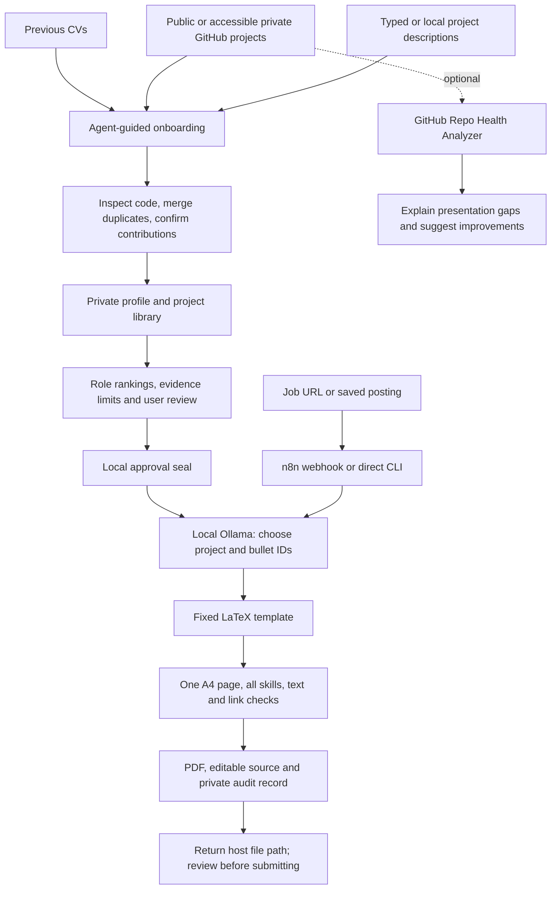

# Evidence CV

**A job link in. A one-page CV built from your verified work out.**

Use your coding agent to build a private career library from previous CVs, GitHub and your own descriptions. Then generate job-tailored PDFs locally with Ollama. The model chooses approved evidence; it cannot freely rewrite your career history.

## How it works



## Quick start with Codex or Claude

Requirements: Git, Docker with Linux containers, and enough RAM for your chosen local model. NVIDIA GPU use is optional. Windows PowerShell helpers are included; other operating systems can use Docker Compose and the Python CLI. GitHub CLI is optional for authenticated collection. No OpenAI/Anthropic keys are required for automated generation. Initial image/model downloads and job-page fetching need internet; model inference stays local.

```powershell
git clone https://github.com/ammar31mawassi/evidence-cv.git
cd evidence-cv
./setup.ps1
```

Then open this checkout in your coding agent and ask:

> Follow AGENTS.md. Help me build my private profile and project inventory from my previous CVs, GitHub and project descriptions. Verify evidence, distinguish my contributions from team/upstream work, rank projects for different roles, and show me the facts before sealing setup. Keep all personal information out of Git.

`CLAUDE.md` points Claude to the same instructions. The agent can only inspect files/repositories you grant it access to. An agent session may have its own subscription; it is not a runtime dependency or a claim that all coding agents are free. The automated service uses local Ollama.

After setup:

```powershell
# A new PowerShell terminal loads the installed function.
job-cv 'https://company.example/careers/specific-job'
job-cv 'https://company.example/careers/specific-job' -DescriptionFile './private/posting.txt'
```

The command prints the validated PDF's absolute host path. Names use `Company_Role.pdf`; duplicate names get `_2`, `_3`, etc. No dates and no overwriting earlier versions. n8n runs at http://127.0.0.1:5681; create a local owner account on the first UI visit. Two published workflows handle submission and progress. Existing applications using ports 5681/8012/11436 must be stopped or the ports and command configured separately.

## Manual / cross-platform setup

```bash
cp .env.example .env
# Set JOB_CV_OUTPUT_DIR to your host's absolute output folder.
docker compose build worker
docker compose run --rm --no-deps worker python -c "print('Worker installed')"
docker compose up -d
docker compose exec ollama ollama pull qwen3.5:4b
```

Run onboarding tools on your host with Python 3.12 and `pip install -r requirements.txt`, or in the worker with writable `private/` mounted for onboarding:

```bash
docker compose run --rm --no-deps -v "$PWD/private:/sources" worker python manage.py --private /sources init
```

`init` copies fictional examples only. Replace every fictional fact. The agent edits `private/profile.json` and `private/projects.json`; inspect the example schemas. After user review:

```bash
python manage.py collect --cv /path/to/previous-cv.pdf
python manage.py collect --github YOUR_USERNAME
python manage.py validate
python manage.py rankings
python manage.py seal --approve
```

For a direct run without n8n, with Python dependencies, local Ollama (default localhost:11434) and `pdflatex` or Tectonic installed (set `TECTONIC_PATH` if it is not on PATH):

```bash
python run_cv.py 'https://company.example/careers/specific-job'
```

Or reuse the built worker and its Ollama connection:

```bash
docker compose run --rm worker python run_cv.py 'https://company.example/careers/specific-job'
```

The Python CLI and n8n call the same generation engine. A changed profile/project file invalidates the approval seal. Review the changes and reseal; never auto-approve unknown claims.

## Evidence, rankings and privacy

- Every project has implementation evidence, personal contribution, claim limits, role ratings and source-linked approved bullets. A CV claim or repository dependency alone is not proof of feature ownership.
- Technical depth, evidence strength and presentation readiness are rated separately. Role rankings determine selection; public/private access is not a technical quality score. Ratings are explained judgments, not hiring predictions.
- All verified skills stay in the CV, grouped into labeled categories and ordered by job relevance. Weaker project content is shortened when necessary to keep exactly one A4 page. Fonts/margins stay readable; the PDF is never cropped.
- The local approval seal detects edits, not truth. Human evidence review is still essential. Review generated PDFs before submitting.
- `private/`, `state/`, `output/` and `.env` are ignored and excluded from Docker builds. Generated PDFs, screenshots and career records belong there. Only fictional fixtures belong in public examples.
- Optional GitHub authentication uses your existing `gh` login; no tokens are copied into configuration. Public health checks use unauthenticated requests and may encounter rate limits.

## Companion tools

See [related projects](docs/related-projects.md). The [GitHub Repo Health Analyzer](https://github.com/ammar31mawassi/repo-health-analyzer) adapter calls its real scoring module and records specific findings. A low score suggests presentation improvements; it never authorizes automatic GitHub changes. The [AI Job Tracker](https://github.com/ammar31mawassi/ai-job-tracker) is an optional separate application tracker.

## Development and checks

```bash
pytest -q
git add AGENTS.md README.md  # stage only reviewed generic files
python privacy_check.py
```

Docker tests: `docker compose run --rm --no-deps worker python -m pytest -q`. Tests use fictional identities and source-backed fixture records. No private user data is needed in CI. Before publishing, inspect the complete staged diff and history too; ignore rules cannot undo an earlier disclosure.

### Validation status

The initial release was tested with fictional identity changes, approval invalidation, source requirements, role rankings, private-link exclusion, skill preservation, structured Ollama request/response tests and actual PDF compilation with Tectonic. The companion scoring adapter was run against a public account. Three personal role showcases were agent-selected and compiled through this generic engine; they are not included in the repository. They demonstrate rendering and evidence selection, not a benchmark of a local model's writing quality.

Docker Desktop failed to start on the release machine, so a fresh end-to-end n8n/Ollama deployment of this generalized version has not been verified there. The earlier personal workflow used this architecture, but that does not replace testing a clean installation. CI performs a fresh Linux/TeX fixture test; its status should be checked before relying on a release.

## Limitations

Requires at least three approved projects. Optimized for English CVs in software roles; current role taxonomy is engineering-oriented. Models vary in selection quality and speed. Extraction can fail on login, captcha, expired or multi-job pages; supply complete saved text instead. Very long contact lines or large career records can fail one-page checks; simplify presentation with the user rather than fabricate or crop. Unicode-heavy content may need a different TeX engine/fonts. This is a personal local tool, not a hardened internet-facing multi-user service. Restart interruption marks an active generation failed; queued jobs resume. PDF checks cannot guarantee any employer's ATS or recruiter response.

## License

MIT. Companion projects retain their own licenses. n8n is a separately distributed dependency with its own terms; this repository does not relicense it or the local model weights.
