# Extraction reliability and local job discovery

Research reviewed November 1, 2026. The research below describes adoption choices; the current implemented discovery, email, scheduling, evidence retrieval and optional Crawl4AI fallback are documented in [the implementation guide](discovery.md). Other suggestions remain proposals. Repository features are source/documentation observations, not independent quality benchmarks. No source code from the three job-search repositories was copied; Crawl4AI is an optional installed dependency with attribution in NOTICE.

## Diagnosis and immediate changes

The reported Google and Ashby failures already had substantial full posting text saved in `state/*/posting.json`. They failed during local-model identity verification, not HTML retrieval. LinkedIn search-results links were a separate extraction failure. Windows PowerShell also removed embedded quotes from the inline Python readiness command.

Implemented fixes: a standalone career-readiness script; canonical LinkedIn IDs and public detail-fragment extraction; source-owned single-posting identity metadata; Google detail-page title extraction (its h1 can simply say “job details”); authoritative source identity instead of the model's reformatted title; raw analysis diagnostics on failure; expired-date and explicit closure checks; bounded Docker CLI readiness probes. Requirement quotations remain grounded against the source. This does not prove that every site or complete CV generation succeeds.

Validation: 26 Python tests passed, including actual fictional-profile PDF checks. Launcher contract tests passed in PowerShell 7 and Windows PowerShell, and live Windows PowerShell startup passed after replacing inline Python. All three user-reported URLs passed live fetching and local Qwen job analysis after the fix. The Google case also exposed a curly-versus-straight apostrophe mismatch; grounding now normalizes typography while still rejecting changed qualifications. The worker image was rebuilt and restarted. Full CV generation for all three postings was not repeated in this investigation.

## Which external projects help

| Project | Useful components/patterns | Adoption boundary |
| --- | --- | --- |
| [Freehire](https://github.com/strelov1/freehire) | Employer/ATS adapters, normalized job schema, provider/external-ID deduplication, cooldowns, last-seen/changed tracking, source provenance. [Ashby adapter](https://github.com/strelov1/freehire/blob/main/internal/ingest/linksource/ashby.go) resolves board + UUID through the public board API. [Architecture](https://github.com/strelov1/freehire/blob/main/docs/architecture.md) separates scheduled ingest from serving. | Reuse adapter ideas first. Its Go/Postgres/Meilisearch/Redis/object-storage platform is much more than a personal CV worker needs. Its keyless public catalog API is an optional external job-data source, not local hosting or permission to upload private career records. Measure Israel/junior coverage before relying on it. |
| [Career Ops](https://github.com/career-ops-hq/career-ops) | [API-first fetch entry point](https://github.com/career-ops-hq/career-ops/blob/main/fetch-jd.mjs), provider-aware extraction, [Ollama evaluator](https://github.com/career-ops-hq/career-ops/blob/main/ollama-eval.mjs), fit frameworks, caching and [golden-set evaluations](https://github.com/career-ops-hq/career-ops/blob/main/evals/README.md). | Adapt small contracts and tests rather than a large agent prompt. Its evaluation references are task/profile-specific, not a hiring-probability metric or a benchmark proving our 4B model is sufficient. |
| [AI Job Search](https://github.com/ai-job-search-dev/ai-job-search) | Separate setup, scrape, rank, application drafting/review, interview prep and outcome tracking; portal CLI tests; [LinkedIn ID validation/detail fetching](https://github.com/ai-job-search-dev/ai-job-search/blob/master/.agents/skills/linkedin-search/cli/src/commands/detail.ts); submission archives and evidence-based interview stories. | Main workflow is built around Claude Code and is not automatically a free Ollama replacement. Its portal defaults focus on Denmark, so replace the source configuration for Israel. Preserve our ignored private records instead of copying a tracked-profile layout. |

All three repositories declare MIT licenses at review time. If copying implementation or prompts, pin the upstream commit, inspect file-level/dependency terms and preserve applicable license/copyright notices in a third-party notice file. No upstream project has been installed as a skill here.

## Crawling choice

Recommended order: canonicalize URL → ATS/public structured data → JSON-LD/scoped HTML → existing Playwright rendering → optional richer browser extraction → saved/pasted text when login, CAPTCHA or blocking prevents access. Keep source checks on redirects and browser requests. A crawler is not a replacement for identifying the right posting or validating model output.

- [Crawl4AI](https://github.com/unclecode/crawl4ai): implemented as an optional local browser fallback without LLM extraction. Its [license](https://github.com/unclecode/crawl4ai/blob/main/LICENSE) includes an explicit attribution requirement; the required credit is in NOTICE. Enable it using the local build/environment settings in the implementation guide.
- [Firecrawl](https://github.com/firecrawl/firecrawl): offers a self-hosted scraping API, useful if several tools need a common scraper. Its [self-hosting guide](https://docs.firecrawl.dev/contributing/self-host) distinguishes local capability from hosted features and optional providers. More services and operational work are involved. The repository declares AGPL-3.0; do not paste its code into an MIT project without addressing the license obligations. Self-hosting does not make every cloud/provider-backed feature free.
- [JobSpy](https://github.com/speedyapply/JobSpy): possible discovery connector for several boards, not a universal job-description reader. Validate current source support, throttling and Israel coverage. Do not make proxy subscriptions a required dependency.

## Proposed n8n discovery workflow

```mermaid
flowchart LR
    A[Local n8n schedule] --> B[Approved employer boards and optional catalog feeds]
    B --> C[Normalize, deduplicate and check freshness]
    C --> D[Hard eligibility and preference filters]
    D --> E[Local Qwen: evidence-linked fit analysis]
    E --> F[Local shortlist with reasons and gaps]
    F --> G[User chooses jobs]
    G --> H[Generate and review one-page CV]
    H --> I[Archive posting, CV and outcome]
```

Start with a configurable daily run over a small allowlist, not an unlimited web crawl. Keep `source + external_id`, canonical URL, first/last seen, description hash, location, work mode, seniority, degree status, deadline and application state in SQLite. Reuse existing AI Job Tracker concepts before adding a second competing tracker. Re-fetch selected jobs before CV production. Cache unchanged postings; back off on repeated failures. A run missed while the computer is off needs a deliberate catch-up policy.

Hard filters should distinguish junior/intern positions from jobs requiring substantial industry experience, and distinguish required versus preferred degree completion. Make location, remote eligibility, student availability and language requirements explicit preferences. Unknown is a visible state, not a guessed pass. Show stretch jobs separately. Scores need reasons and supporting evidence, never an implied probability of being hired.

No schedule, external notification, job application or public posting has been enabled by this research. A local shortlist needs no messaging account or paid model key.

## Improving the small local model

1. Build a regression pack of saved postings: LinkedIn selected/search links, Ashby, Google, closed jobs, Hebrew jobs, ambiguous titles, senior-role mismatch, missing degree and quoted requirements. Measure extraction separately from analysis, selection, factual accuracy, PDF layout and latency.
2. Expand the private evidence bank with approved bullet variants, concrete feature ownership, measured outcomes only when supported, courses/grades and dates. Give each statement an ID and source. Put drafting choices under the same review seal.
3. Have the model choose requirement IDs and evidence IDs rather than reconstruct long quotations and rewrite job titles. Preserve source-owned facts deterministically. Keep stage prompts short enough for the hardware/context budget.
4. Improve retrieval before adding a vector service: lexical/BM25 ranking plus role ratings and complementary-project rules can be tested with the current small portfolio. Add local embeddings only if benchmark cases show missed matches; they retrieve evidence, not create qualifications.
5. Separate fit assessment, project selection and constrained writing. Run deterministic checks after each stage. A second model pass can suggest revisions, but it cannot certify truth; require evidence references and preserve the one-page/all-skills rules.
6. Compare Qwen and DeepSeek on the same labeled postings and bank, including speed/memory. Do not switch on generic benchmark claims. Prompt/evidence refinement is different from weight fine-tuning; LoRA training is a later experiment requiring enough curated examples and held-out evaluation.

Priority: fix/retest the current path → add a small evaluation pack → deepen evidence and role-specific summaries → add local discovery/ranking → outcome tracking and interview prep. Defer automatic applications, a full recruitment platform and weight training.
